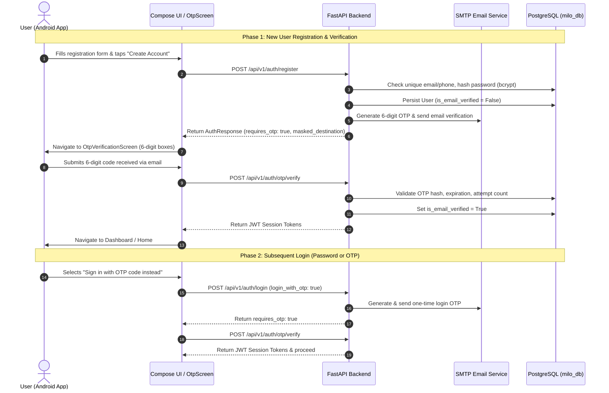

# MILO — Smart Cab Pooling & Social Commute Platform

[](https://fastapi.tiangolo.com)
[](https://developer.android.com/jetpack/compose)
[](https://www.postgresql.org)
[](https://www.python.org)

MILO is a full-stack social commute and cab pooling mobile application and backend platform designed for secure, verified, and cost-effective ride-sharing across campus and metropolitan environments.

---

## 🏗️ Architecture Overview

The system is partitioned into two core modules:
1. **`app/`**: Android Jetpack Compose client (Kotlin, Material 3, OkHttp, Coroutines, State-driven navigation).
2. **`backend/`**: High-performance FastAPI REST backend (SQLAlchemy ORM, Alembic migrations, PostgreSQL, JWT + OTP multi-factor authentication, SMTP / Twilio dispatch).

```
MILO/
├── app/                     # Android Jetpack Compose Native Mobile App
│   ├── src/main/java/       # Kotlin UI screens, navigation, and API client
│   └── build.gradle.kts     # Android build & auto-backend orchestration task
├── backend/                 # FastAPI REST API Backend
│   ├── app/                 # Core engine, API routers, models, schemas, services
│   ├── migrations/          # Alembic database migration revisions
│   ├── tests/               # Pytest unit & integration test suites
│   ├── Dockerfile           # Multi-stage production container build
│   └── pyproject.toml       # Python packaging, Ruff, Black, Pytest configuration
├── docker-compose.yml       # Production-ready PostgreSQL & FastAPI orchestration
├── run_milo.bat             # 1-Click developer launcher for backend
└── README.md
```

---

## 🔐 Authentication & Verification Architecture

MILO implements an **Email-Verified Zero-Trust Onboarding Flow** to eliminate invalid, spam, or malicious user accounts:



### Security Highlights
- **Salted Bcrypt Hashing:** Passwords are never stored in plaintext (`AUTH-08`).
- **Cryptographic OTP Generation:** 6-digit codes generated using `secrets.SystemRandom()`.
- **Brute-Force Throttling:** 10-minute validity window, maximum 5 attempts per OTP code (`AUTH-09`).
- **Email Delivery Fallback:** Full MIME HTML/plaintext delivery via SMTP (Gmail / SendGrid / Postmark). In development/local environments, simulated delivery logs the OTP directly to the developer console for friction-free testing.

---

## 🚀 Quickstart Guide

### Prerequisites
- **Java JDK 17+**
- **Android Studio** (Ladybug / Koala or newer) with an active Android Virtual Device (AVD, e.g. Pixel 9a API 35)
- **Python 3.12+**
- **PostgreSQL 16** (running locally on port 5432 or via Docker)

### 1. Database Setup
```bash
# Option A: Native PostgreSQL
psql -U postgres -c "CREATE DATABASE milo_db;"

# Option B: Docker Compose
docker compose up -d db
```

### 2. Running Backend
The backend can be started using the 1-click Windows launcher:
```bat
run_milo.bat
```
Or directly using Python in `backend/`:
```bash
cd backend
.venv\Scripts\activate
uvicorn app.main:app --host 0.0.0.0 --port 8000 --reload
```
Once running:
- **Host Endpoint:** `http://127.0.0.1:8000`
- **Android Emulator Endpoint:** `http://10.0.2.2:8000`
- **Interactive Swagger Docs:** `http://127.0.0.1:8000/docs`

To send OTPs to a real inbox instead of the development console, add the SMTP
settings from `backend/.env.example` to your existing `backend/.env` (do not
overwrite its database settings). Fill in the SMTP username, sender email, and
Gmail App Password, then restart the backend. The example file includes Gmail
setup steps; use an App Password, not your normal account password.

### 3. Automatic Backend Launch via Android Studio
The Android Gradle script (`app/build.gradle.kts`) includes an automatic startup task:
- When you execute `./gradlew assembleDebug` or click **Run** in Android Studio, Gradle queries the backend healthcheck. If not running, it automatically spins up the FastAPI server on port 8000.

### 4. Running Backend Unit & Integration Tests
```bash
cd backend
.venv\Scripts\python.exe -m pytest tests -v
```

---

## 📡 Core API Reference

| Endpoint | Method | Description |
| :--- | :--- | :--- |
| `/api/health` | `GET` | Healthcheck and readiness probe |
| `/api/v1/auth/register` | `POST` | Registers user, hashes password, triggers email OTP |
| `/api/v1/auth/login` | `POST` | Authenticates with password or initiates OTP login |
| `/api/v1/auth/otp/send` | `POST` | Dispatches 6-digit verification code to email/phone |
| `/api/v1/auth/otp/verify` | `POST` | Validates OTP, marks account verified, issues JWT |
| `/api/v1/auth/refresh` | `POST` | Exchanges valid refresh token for access token |
| `/api/v1/auth/logout` | `POST` | Revokes refresh token and terminates session |
| `/api/v1/auth/me` | `GET` | Returns authenticated user profile |
| `/api/v1/auth/change-password`| `POST` | Updates password and revokes previous sessions |

---

## ⚖️ License
Proprietary — Developed for the MILO Major Project.
